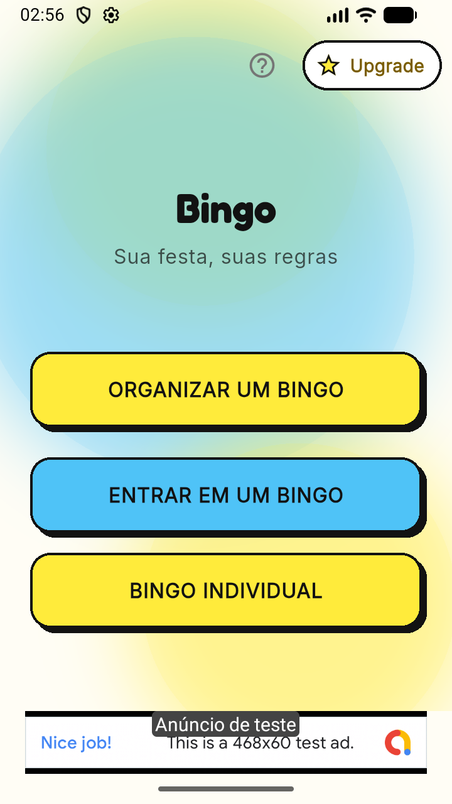
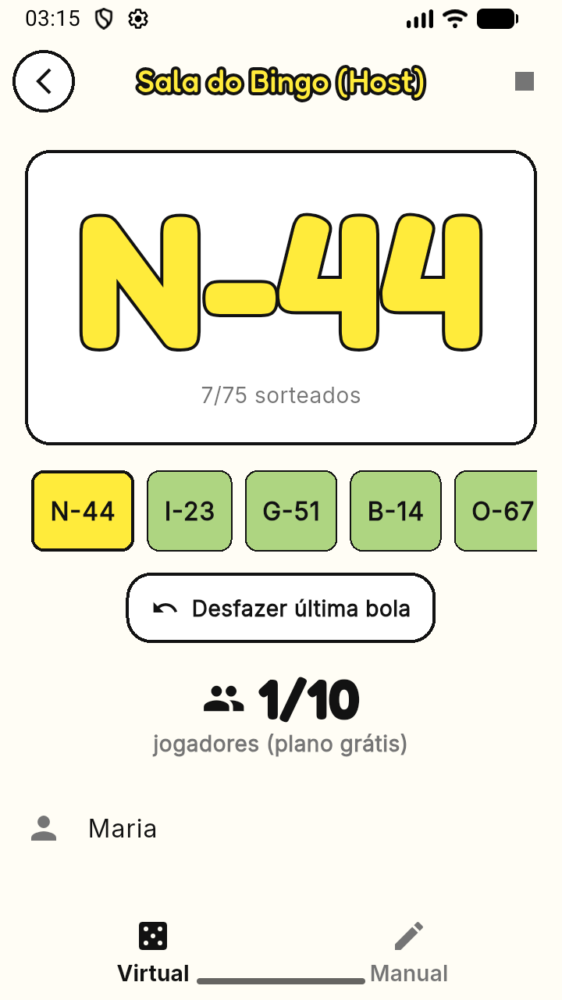
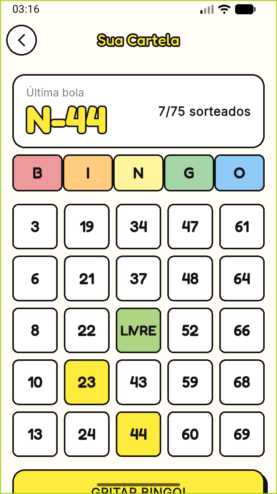

# Bingo

**Party bingo over local Wi-Fi, no server, no internet, no sign-up.** The host's phone becomes the bingo cage *and* the game server; guests scan a QR code and play on their own phones with digital cards.

Built with Flutter. Android-first, iOS-ready.

<p align="center">
  
  
  
  
</p>

## Download

Grab the latest signed APK from [**Releases**](../../releases). This is the *open edition*: every feature unlocked, no purchases, no ads.

## Features

- **Host as server**: the host phone runs a WebSocket server ([shelf](https://pub.dev/packages/shelf)) on the LAN. Works on a router with no internet or on the phone's own hotspot.
- **QR / link invites** with a per-room JWT whose secret never leaves the host device.
- **Resilient networking**: reconnection with backoff that resumes the same player and card, state sync on rejoin, heartbeat, TCP reachability probe with clear errors ("not on Wi-Fi", "different network", "host unreachable").
- **Host-side validation**: the host checks every BINGO claim deterministically.
- **Manual mode** for physical cages, auto-draw, history, undo, new round.
- **Solo mode** for practice.
- **6 languages**: English, Portuguese, Spanish, French, Italian, Japanese.
- Animated icons rendered with [`lava_flutter`](https://pub.dev/packages/lava_flutter).

## Architecture

```
bingo_core/   SDK: game connection (LAN server/client), invites, JWT, rules,
              access control, drivers behind interfaces (config, payment, network)
bingo_app/    Flutter app: MVVM (view models + views), GetIt DI, go_router,
              flavors dev / alpha / prod, l10n
```

- Everything external sits behind an interface (`IGameConnection`, `IPaymentDriver`, `IConfigDriver`, `INetworkInfoDriver`), so the game logic is tested without devices.
- Monetization code (RevenueCat paywall, AdMob, Remote Config flags) is kept as a reference implementation. **Without a RevenueCat key the app builds as the open edition** (`FreePaymentDriver`): everything is unlocked and no ads are loaded.
- CI on GitHub Actions: analyze + tests on every PR; tag `vX.Y.Z` builds a signed APK and publishes a release.

## Running locally

Requires Flutter **3.38.10**.

```bash
cd bingo_core && flutter pub get && flutter test
cd ../bingo_app && flutter pub get
flutter run --flavor dev -t lib/main_dev.dart
```

Play with two devices (or two emulators) on the same network: one creates a room, the other scans the QR code.

> The Firebase config files in the repo point to the author's project (Crashlytics/Analytics). For your own fork, run `flutterfire configure` to generate yours.

More docs in [`docs/`](docs): product spec, design system, security model, CI/CD.

## License

[MIT](LICENSE) © Matheus Dias

---

### 🇧🇷 Em português

Bingo presencial pela rede Wi-Fi: o celular do anfitrião vira o globo e o servidor do jogo, e os convidados jogam com cartelas no próprio celular, sem internet e sem cadastro. Baixe o APK em [Releases](../../releases). Edição aberta: tudo liberado, sem compras e sem anúncios.
